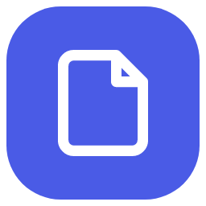
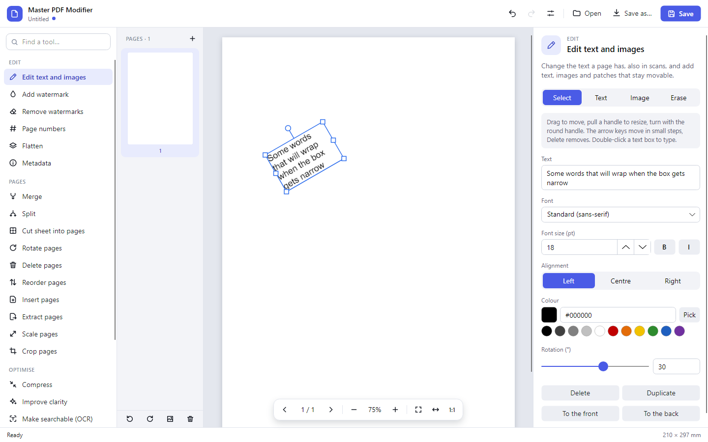
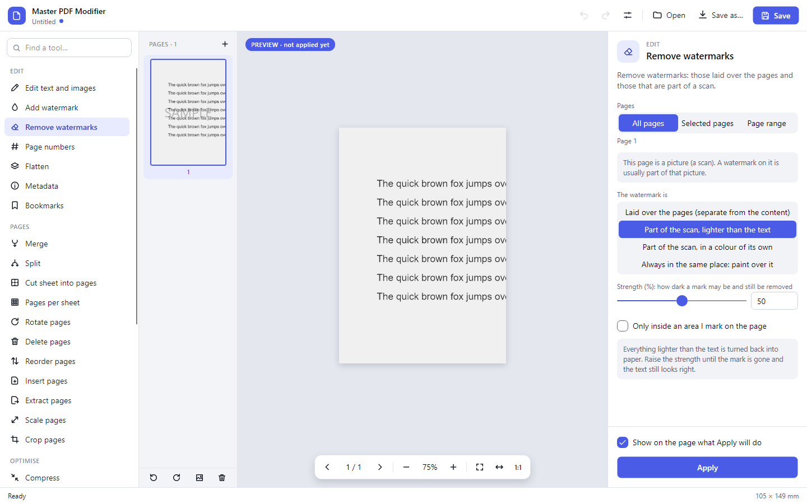
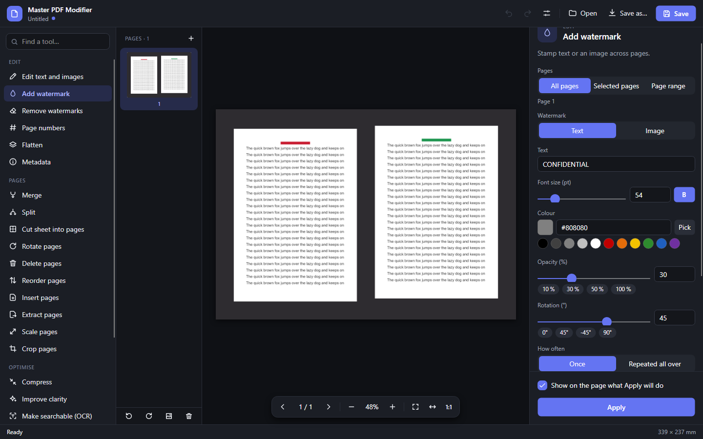
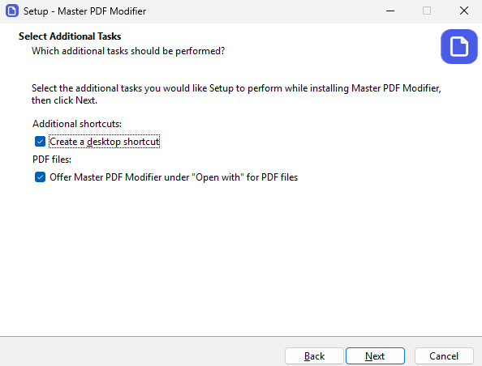

<p align="center">
  
</p>

<h1 align="center">Master PDF Modifier</h1>

<p align="center">
  A free, open-source desktop app for editing, organising, cleaning up and compressing PDF files.<br>
  It works on scanned pages as well as on typed ones. For Windows and Linux.
</p>

<p align="center">
  
  
  
  
</p>

<p align="center">
  
</p>

## What it can do

22 tools in four groups, all in one window:

| Group | Tools |
| --- | --- |
| **Edit** | Change the text and images of a page, add text boxes and pictures, erase · add a watermark · remove watermarks · page numbers · flatten · metadata |
| **Pages** | Merge · split · cut a sheet that shows several pages into pages of their own, without the scanner edge and shadows around them · turn and mirror, and set upright the pages that lie on their side · delete · reorder · insert (blank pages, other PDFs, images) · extract (to PDF or PNG/JPEG/WebP) · scale · crop |
| **Optimise** | Compress one document or a whole folder · improve the clarity of scans · make scans searchable (OCR) · automate a chain of steps |
| **Review and protect** | Compare two PDFs · protect with a password |

## What sets it apart

- **Scans are not second-class.** Most PDFs people actually have are pictures of pages. Text is found in them by
  text recognition and can be changed; watermarks are removed whether they lie over the page or are part of the
  scanned picture; pages that mix a scan with typed text have both kinds offered side by side.
- **You see what a tool will do before it does it.** Watermarks, page numbers, scaling, compression, clean-up and
  watermark removal are shown on the page while you change their settings, marked as a preview. Nothing changes
  until you press Apply, and everything can be undone.
- **It says when it is not sure.** Where the app decides something by itself (how a sheet divides into pages, where
  a page ends, which pages are turned, what a blurry line says), a slider sets how readily it decides, and what it
  doubts is marked red so you can check, correct or leave it out.
- **Settings are quick to set.** Choices are buttons that are all on view, not lists to open; the values wanted most
  stand under their sliders; where something goes on a page is clicked on a small picture of one; and every tool
  says which pages it is going to work on.
- **Your files stay on your computer.** No account, no upload, no tracking. The only things ever fetched from the
  internet are what text recognition needs (language data from the official Tesseract project and, where it is
  missing, the runtime or program it runs on) and, if you want them, new versions of the app itself; each only
  after the app has asked you.
- **Nothing to set up by hand.** A setup that asks what a setup should ask, or one file to start as it is. What the
  app needs beyond itself it fetches on its own, after asking; nobody has to open a command line.
- **New versions, if you want to hear of them.** The app asks once. With a yes it takes one look per start and
  puts a warning sign on the settings button when there is a newer version; **Update now** then fetches it, checks
  it and puts it in place. With a no it never connects for this.
- **It leaves when you tell it to, and takes its things along.** No background service, no start with Windows, no
  icon in the tray, nothing running once the window is closed. Removing it takes away the program, its shortcuts,
  what Windows knew it by and what it kept in the temp folder, and asks whether your settings should go too.
- **Eight interface languages**: English, Español, Deutsch, Русский, Français, 日本語, Português and Türkçe. Light
  or dark follows the setting of your desktop.

## A closer look

<table>
  <tr>
    <td width="50%" valign="top">
      <br>
      <b>Edit text, also in scans.</b> Blue is text of the document, orange is text found in the page image.
      Click a line, type, apply.
    </td>
    <td width="50%" valign="top">
      <br>
      <b>Add text and images that stay objects.</b> Move, resize, turn and restyle them at any time, also after
      the file was saved and opened again.
    </td>
  </tr>
  <tr>
    <td width="50%" valign="top">
      <br>
      <b>Remove watermarks with a preview.</b> Here the mark is part of the scan; the list on the left still shows
      the page as it is.
    </td>
    <td width="50%" valign="top">
      <br>
      <b>Clean up poor scans.</b> Say what is wrong with the pages (blurry, faint, a photograph with shadows) and
      adjust the steps with the result on view.
    </td>
  </tr>
  <tr>
    <td width="50%" valign="top">
      <br>
      <b>Doubts are marked red.</b> Lines that text recognition more guessed at than read can be read again, more
      carefully, one area at a time.
    </td>
    <td width="50%" valign="top">
      <br>
      <b>Light and dark.</b> The same window on a dark desktop.
    </td>
  </tr>
</table>

Every tool is described in the **[guide](docs/GUIDE.md)**, together with the keyboard and mouse shortcuts and the
limits worth knowing.

## Get it

<p align="center">
  <a href="https://github.com/ZeronTwoi/MasterPdfModifier/releases/latest/download/MasterPdfModifier-Setup.exe"><b>Download for Windows</b> (setup)</a>
  &nbsp;·&nbsp;
  <a href="https://github.com/ZeronTwoi/MasterPdfModifier/releases/latest/download/MasterPdfModifier.deb"><b>Download for Linux</b> (.deb)</a>
</p>
<p align="center">
  <a href="https://github.com/ZeronTwoi/MasterPdfModifier/releases/latest/download/MasterPdfModifier.exe">Windows, without installing</a>
  &nbsp;·&nbsp;
  <a href="https://github.com/ZeronTwoi/MasterPdfModifier/releases/latest/download/MasterPdfModifier-Linux.tar.gz">Linux, other distributions</a>
  &nbsp;·&nbsp;
  <a href="https://github.com/ZeronTwoi/MasterPdfModifier/releases">all versions</a>
</p>

Download it, start it, use it. There is no command line anywhere.

| | Windows | Linux |
| --- | --- | --- |
| **Start it** | Run `MasterPdfModifier-Setup.exe`. The setup speaks the app's eight languages and asks where to install, which shortcuts you want (Start menu, desktop) and whether to offer the app under "Open with" for PDF files; whatever opens your PDF files now goes on doing so. It installs for you alone, so no administrator is needed. Rather not install anything? `MasterPdfModifier.exe` is the whole app in one file: double-click it, wherever it lies. | Debian, Ubuntu, Mint and their relatives: open `MasterPdfModifier.deb` and let the software centre install it; the app is in the application menu afterwards. Others: unpack the archive and start `MasterPdfModifier`; it offers to put itself into the application menu. |
| **What it fetches by itself** | Language data for text recognition. On a freshly set-up Windows also the Microsoft Visual C++ runtime, which the text recognition is built on, straight from Microsoft. | Language data for text recognition. The Tesseract program, where it is not installed yet, from the distribution (the package brings it along). |

<p align="center">
  
</p>

Windows may say that it does not know the setup or the app, because they are new and not signed: choose *More
info*, then *Run anyway*. Whoever wants to be sure the file is the one that was published can compare it with
`SHA256SUMS.txt`, which every version comes with.

The app asks before it fetches anything and says what it is and where it comes from; after a yes it does the rest.
"Not now" is a fine answer: everything but text recognition works without. The one-file app takes a few seconds
longer at its very first start, because it unpacks what it is made of.

**New versions.** The first time it is started the app asks whether it should tell you when a new version is out.
With a yes it looks once each time it is started: a single request to GitHub that is answered with the number of the
newest version, without anything about you or your documents in it. When there is a newer one, the settings button
gets a warning sign and the settings say which version it is. **Update now** does the rest: it fetches the new
version from GitHub, checks that it is the file that was published, puts it in the place of the old one and starts
the app again with the document you had open. Nothing is fetched before you press that button, and *See what is
new* shows what you would be getting. With a no the app never connects for this, and it does not ask again; the
settings have a box to change your mind.

**Removing it.** The installed app is removed like any other, under *Installed apps* in the Windows settings. That
takes away the program, its shortcuts and pins, its entry under "Open with", and what it left in the temp folder;
it asks whether your settings and the downloaded language data should go as well, and with a yes nothing of the app
is left on the computer. It does not remove an app that is still open, it asks you to close it first. The one-file
app has nothing installed: delete the file. On Linux, remove the package in the software centre.

Every release is started by the build itself, on Windows and on Ubuntu, before it is handed out. Beyond that, Windows
is where the app has been used most; Linux has been tried far less, and reports of what works and what does not are
welcome.

## Using it

Open a PDF, or drop pictures into the window to start a document from them. Pick a tool on the left, set it up on
the right, look at the preview on the page, press **Apply**. **Ctrl + Z** takes a step back, **Save** writes the
file. Type a word into the box above the tools to find one by its name or by what it does.

The [guide](docs/GUIDE.md) has the rest.

## For developers

Building from the source takes the [.NET 10 SDK](https://dotnet.microsoft.com/download):

```
git clone https://github.com/ZeronTwoi/MasterPdfModifier.git
cd MasterPdfModifier
dotnet run --project PdfModifier
dotnet test
```

- `PdfModifier.Core` – all PDF work, no user interface. Every operation takes a document as bytes and returns a new
  one.
- `PdfModifier` – the desktop app (Avalonia). Its program file is called `MasterPdfModifier`.
- `PdfModifier.Tests` – unit tests for the core, and tests that drive the real window with mouse and keyboard
  without needing a screen.
- `packaging` – what the Windows installer (Inno Setup) and the Linux package are made from, and the text that goes
  with a release.
- `docs` – the guide and the pictures on this page.

**The downloads** are made by `.github/workflows/downloads.yml`. To publish a new version, raise `<Version>` in
`PdfModifier/PdfModifier.csproj` and push to `main`: the tests run, the four downloads are built, each is tried
(the installer by `packaging/windows/try-setup.ps1`: installing, updating the way the app updates itself, changing
the choices, removing, and looking each time at what is on the computer), and all are attached to a release named
after the version, together with `SHA256SUMS.txt`. Apps that are told about new versions find it there, and update
themselves from it: each from the download it came as, after checking it against that list. The one-file build can
be made by hand, and asked whether it has all it needs and what kind of download it takes itself for:

```
dotnet publish PdfModifier -c Release -r win-x64 -p:PublishSingleFile=true -o publish
publish/MasterPdfModifier.exe --check
```

The app keeps its settings in the user's configuration folder; `PDFMODIFIER_SETTINGS` names another file for them,
for a copy that is carried around or for trying a first start again.

The test suite generates its own documents. Four optional environment variables:

- `PDFMODIFIER_TESSDATA` – a folder with `*.traineddata` files. Recognition tests run when the data is there and are
  skipped otherwise. The app honours the same variable, for example for a portable install.
- `PDFMODIFIER_SCREENSHOTS` – a folder to receive pictures of the window in each tested state. The pictures on this
  page were made that way.
- `PDFMODIFIER_SAMPLES` – a folder to receive sample files for trying things by hand: a text document, scans, sheets
  with several pages, a page of paragraphs, a blurry scan.
- `PDFMODIFIER_NETWORK` – set to anything, lets the one test run that downloads for real: it fetches Microsoft's
  installer of the Visual C++ runtime (some 25 MB) and checks its signature, without running it.

A tool that fails tells the user so in a message box. Without a screen nobody can close it, so the window tests only
drive what succeeds; `dotnet test --blame-hang --blame-hang-timeout 200s` ends a run that hangs all the same. For
the same reason the app asks its questions about fetching things only when it was started as a program: in the tests
nobody is there to answer, and they put their own answers in place.

## Feedback

This is an early version. If something does not work, or a tool does less than you need, please open an issue and
say what kind of PDF it was (typed, scanned, or both) and what you expected to happen.

## Licence

Master PDF Modifier is released under the [MIT licence](LICENSE): free to use, change and pass on, also commercially, as
long as the licence text stays with it.

## Built on

Master PDF Modifier stands on the work of these open-source projects. None of them is a paid or restricted product; each
remains under its own licence, which asks for the credit given here.

| Project | What it does here | Licence |
| --- | --- | --- |
| [PDFium](https://pdfium.googlesource.com/pdfium/), in the builds of [pdfium-binaries](https://github.com/bblanchon/pdfium-binaries) | Showing pages, reading their text, editing pages and what is on them | BSD-3-Clause / Apache-2.0 |
| [PDFsharp](https://github.com/empira/PDFsharp) | Metadata, password protection, removing unused objects | MIT |
| [Tesseract OCR](https://github.com/tesseract-ocr/tesseract) and [Leptonica](http://www.leptonica.org/) | Text recognition | Apache-2.0 / BSD-2-Clause |
| [Tesseract .NET wrapper](https://github.com/charlesw/tesseract) | Loading Tesseract on Windows | Apache-2.0 |
| [tessdata_fast](https://github.com/tesseract-ocr/tessdata_fast) (downloaded on request, not included) | Language data for text recognition | Apache-2.0 |
| [SkiaSharp](https://github.com/mono/SkiaSharp) and [Skia](https://skia.org/) | Reading, writing and drawing images | MIT / BSD-3-Clause |
| [Avalonia](https://github.com/AvaloniaUI/Avalonia) | The user interface | MIT |
| [HarfBuzz](https://github.com/harfbuzz/harfbuzz) | Shaping the text of the interface | MIT |
| [ANGLE](https://chromium.googlesource.com/angle/angle) | Drawing the interface on Windows | BSD-3-Clause |
| [CommunityToolkit.Mvvm](https://github.com/CommunityToolkit/dotnet) | Connecting the interface to the logic behind it | MIT |
| [.NET](https://github.com/dotnet/runtime) | The runtime the app runs on, included in the self-contained builds | MIT |

The full list, with the smaller parts these bring along, is in [THIRD-PARTY-NOTICES.md](THIRD-PARTY-NOTICES.md); it
travels with every build. Fonts are not included: new text uses the fonts installed on the computer. Two things the
app may fetch for text recognition are not part of it either and stay under their owners' terms: the Microsoft
Visual C++ runtime, downloaded from Microsoft, and on Linux the Tesseract program, installed from the distribution.

Master PDF Modifier is an independent project. It is not affiliated with or endorsed by any of the projects and companies
named here; their names are used only to say what the app is built on.
