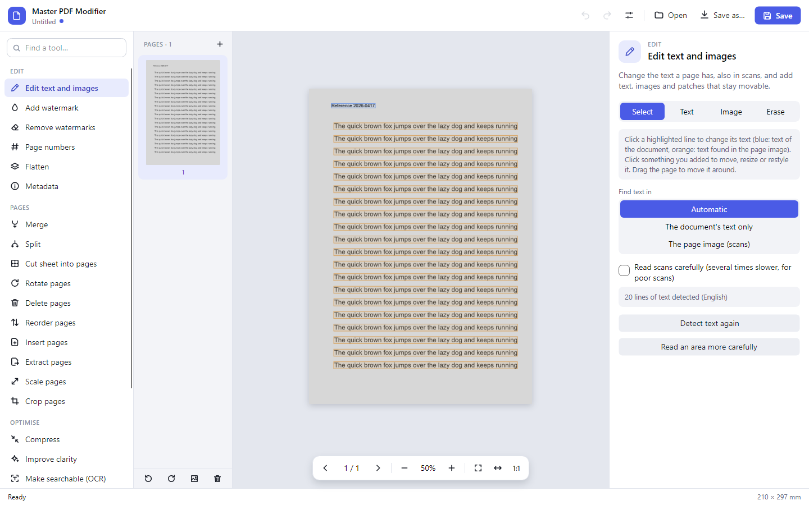
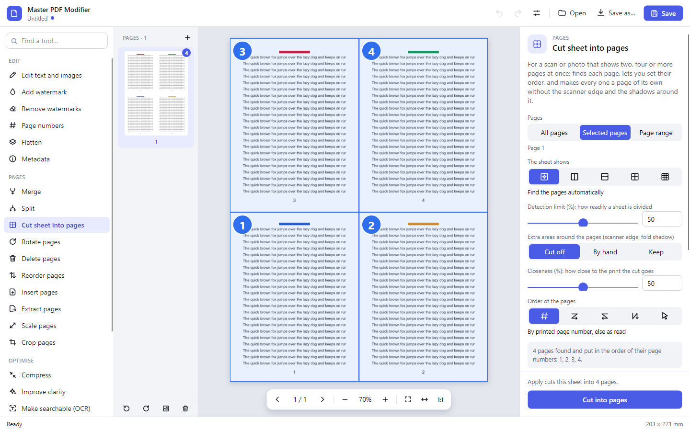
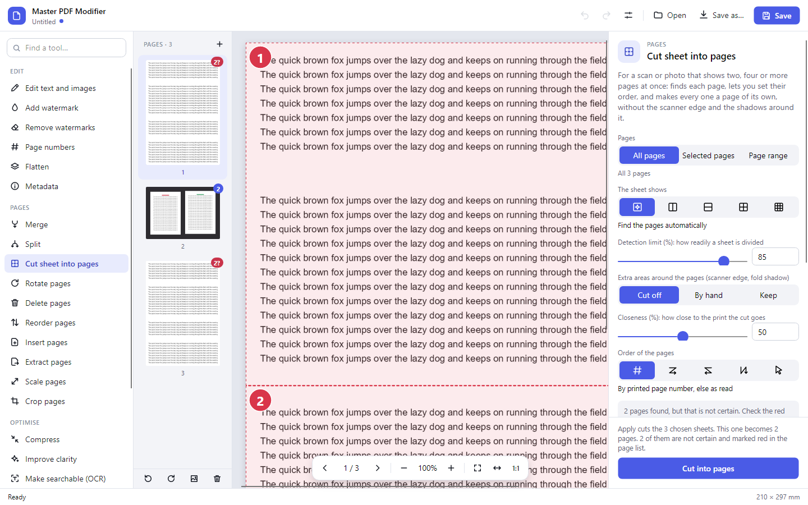
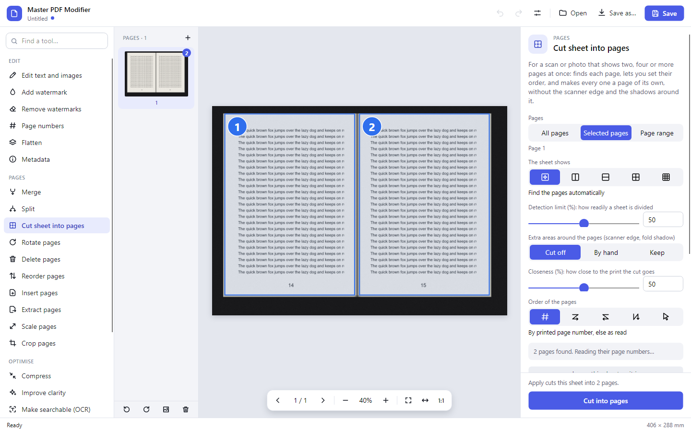
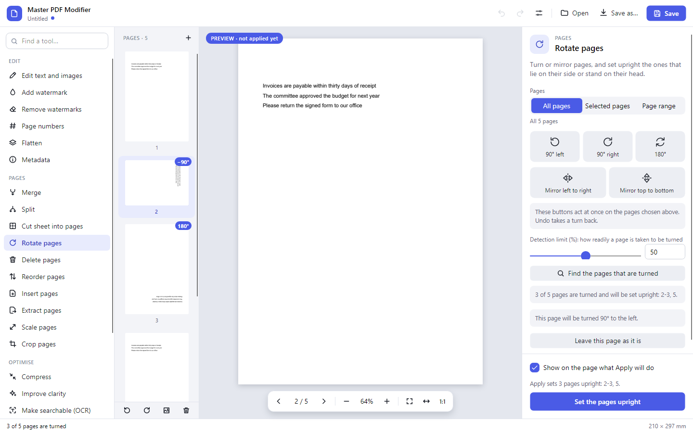
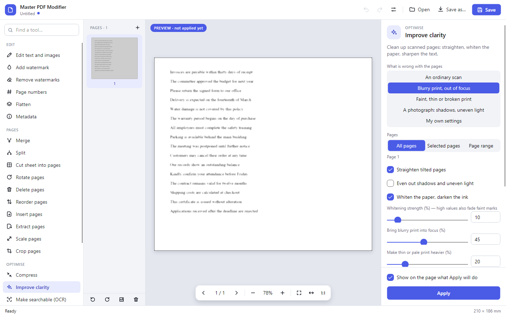
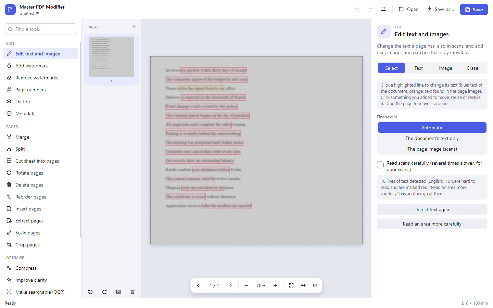
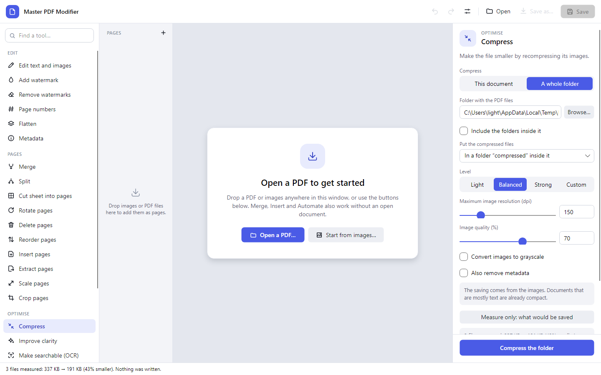
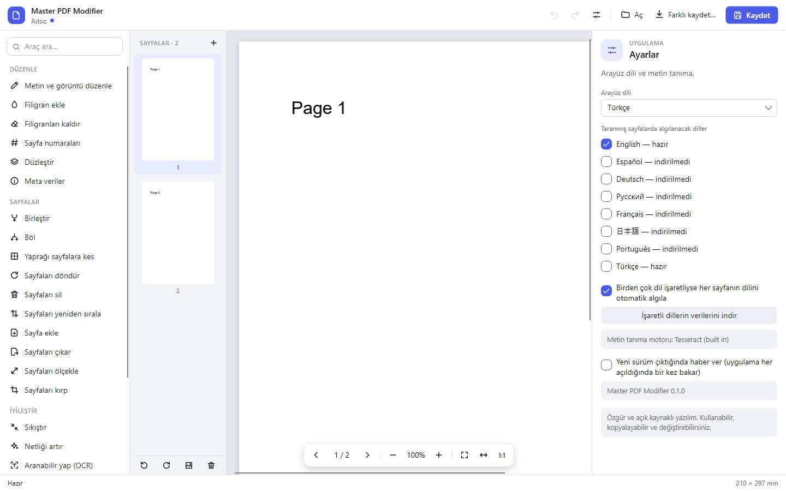
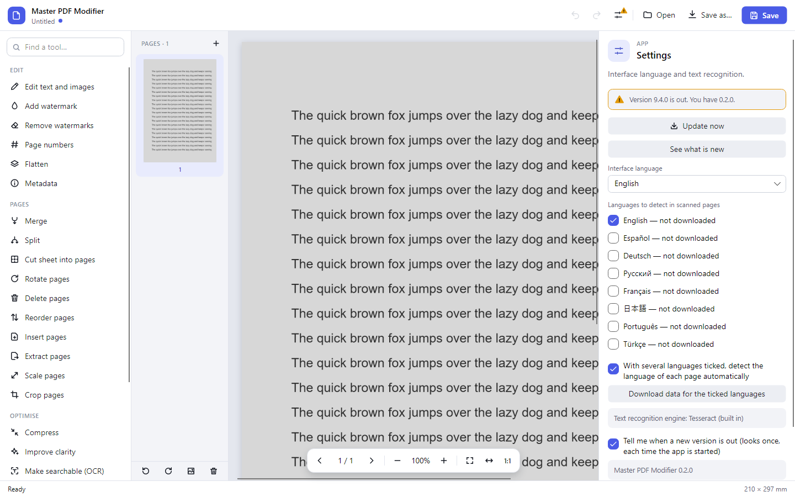

# Master PDF Modifier: the guide

What each part of the app does, how to get around in it, and the limits worth knowing.
The short version is on the [main page](../README.md).

- [The window](#the-window)
- [Typed pages and scans](#typed-pages-and-scans)
- [Edit text and images](#edit-text-and-images)
- [Cut sheet into pages](#cut-sheet-into-pages)
- [Turn and mirror pages](#turn-and-mirror-pages)
- [Settings that are quick to set](#settings-that-are-quick-to-set)
- [The page list](#the-page-list)
- [Poor scans](#poor-scans)
- [Compress](#compress)
- [Automate](#automate)
- [Languages](#languages)
- [What the app fetches by itself](#what-the-app-fetches-by-itself)
- [New versions](#new-versions)
- [Getting around](#getting-around)
- [Good to know](#good-to-know)

## The window

- **Left:** the tools, in four groups (Edit, Pages, Optimise, Review and protect). The box above them finds a tool
  by a word of its name or of what it does.
- **Next to them:** the page list. Pages are selected, reordered, added and removed here.
- **Middle:** the page on view, with the bar for turning pages and zooming under it.
- **Right:** the settings of the tool that is selected, and its **Apply** button.
- **Top:** undo and redo, settings, Open, Save as and Save. A dot next to the file name says there are changes that
  are not saved yet.

## Typed pages and scans

**Pages are text, pictures of text, or both, and the tools work on all three.** A page that is a scan is read by
text recognition; a scan that already carries a search layer brings its text along; a page that mixes a scan with
typed text (a reference number stamped on it, a typed header) has both kinds offered side by side. The same goes for
the other tools: watermarks are removed whether they are objects laid over the page or part of the scanned picture,
"make searchable" adds only what is not text already, clean-up handles scans stored as one picture or in strips.

**You see what a tool will do before it does it.** Watermarks, page numbers, scaling, compression, clean-up and
watermark removal are shown on the page as you change their settings, marked as a preview; cropping shows the part
that will be kept, and a page that was found to be turned is shown the way it will stand. Nothing changes in the
document until you press Apply, and everything can be undone. The few buttons that act at once (a quarter turn, a
mirror image, moving a page) say so, and Undo takes each press back.

## Edit text and images

This tool is an editor, not a form:

- Text the page has is highlighted: blue for text of the document, orange for text found in the page image. Click a
  line, type, apply. In a scan the old line is painted over in the colour of the paper and the new text set in a
  matching size and colour.
- New text goes into a box you draw on the page. Font, size, bold, italic, colour and alignment can be set before or
  after; the box can be moved, resized, turned and typed into again at any time.
- Images are placed by dragging out an area or with a click. Images used before are offered again under the Browse
  button; with the pointer on one (or a right-click) it can be pinned, so it stays however many others follow, or
  taken off the list. They can be moved, resized, turned and faded.
- The eraser is told what it may touch: the page itself, text added afterwards, images added afterwards. The page is
  painted over in the colour around the area or in one you choose.
- What was added stays an object: it can be changed again later, also after the file was saved and reopened here.

## Cut sheet into pages

For a scan or photograph that shows two, four or more pages at once: an open book, pages lying next to each other on
a table, a print with several pages per sheet.

- The pages are found by the paper standing out from what it lies on, by the empty bands between them, or by the
  shadow of a fold. Each is framed on the sheet and numbered with the place it will get.
- Their order follows the page numbers printed on them, which are read from the picture. Pages without a number stay
  where reading order puts them; without any numbers the order is left to right, top to bottom. It can also be set
  to right to left or column by column, or by clicking the pages one after the other.
- Every frame can be moved, resized or removed, and frames can be drawn by hand. When nothing is found the sheet can
  be divided evenly instead (two across, two down, 2 × 2, or any grid). How a sheet is divided and how its pages are
  ordered is chosen from small drawings; what the chosen one stands for is written out under them.
- Cutting gives each page what is on its part of the sheet and nothing else: its text, and of a picture only the
  pixels that show. Several sheets are cut in one go.
- A sheet is only divided when enough speaks for it: a band that is wide for the page, stands out among the other
  gaps on it and matches the margins around it. Gaps between paragraphs do not make two pages of one. How much is
  needed is set with the **detection limit**. Where the outcome is a close call, the frames are red and so is the
  mark the sheet gets in the page list, so one look down the list shows what to check. A doubtful sheet can be
  corrected, confirmed as right, left out, or simply taken out of the selection.

### What lies around the pages

A page as it is found often comes with things that are not page: the dark of the scanner around a book, the rim of
the pages underneath, the shadow in the fold, the black along the edges of a photocopy, the table under a sheet that
was photographed. **Extra areas around the pages** says what is done about them.

- **Cut off** has the app look for where each page really ends. **Closeness** sets how far in the cut goes. Low, it
  takes only what is plainly not page: bands of one shade along a whole side. In the middle it also takes what
  hangs on to the edge up to where clean paper begins: the soft rim of a shadow, a sliver of the page next door, the
  wedge left by a sheet that lies a little askew. At the top end it goes on into the page's own margins, and at 100
  it lies right around the print.
- Nothing is cut for being dark alone. Only what is connected to the edge of the frame is ever taken for not being
  page, so print, which stands free on its paper, stays; a photograph that runs off a page is not of one shade the
  way a scanner lid is, so it stays too; and the cut never crosses print to get at something behind it.
- Where an edge could not be settled (something hangs on to it, and no clean paper follows within reach) the frame
  stays as it was and turns red, and the sheet gets a red mark in the page list, the same way a doubtful division
  does. Pull the frame right, raise the closeness, or say that it is right as it is.
- **By hand** takes strips of a set width off every chosen sheet instead: off its left, right, top and bottom edge,
  and off each page where it meets another (the fold). That is the quick way for a stack of sheets that were all
  scanned the same way.
- **Keep** leaves the pages as they are found.
- A frame that was pulled into place by hand is its owner's: other settings no longer move it, until *Find the pages
  again* starts that sheet over.

A sheet that shows a single page with something around it is cut out of that the same way; it is marked with a 1 in
the page list.

## Turn and mirror pages

- **By hand:** three buttons turn the chosen pages a quarter to the left, a quarter to the right, or half a turn;
  two more mirror them left to right or top to bottom (for a scan made from the wrong side of a transparency, or a
  photograph taken in a mirror). They act at once and can be pressed again; Undo takes each press back.
- **Found by the app:** *Find the pages that are turned* looks at every chosen page. A page of text says itself
  which way it stands, by the direction of its letters. A scan is read by text recognition the way it stands and,
  unless that gives proper words, turned the other ways as well; the way that reads is the right one. This also
  gets poor and slightly tilted scans right.
- Each page that is turned gets the turn it needs written on it in the page list (90°, −90°, 180°), the page on view
  is shown the way it will stand, and **Set the pages upright** turns them all. A single page can be left out, or
  turned by hand instead.
- The **detection limit** sets how readily a page is taken to be turned. A close call is red: a page that was
  turned on thin evidence, or one that was left as it is although it may well be turned. Moving the limit judges the
  same evidence anew at once; the pages are not looked at again for that.
- Without text recognition a scan is judged by the look of its print alone. That shows a page lying on its side.
  Which way up it stands shows only for Latin script, where more rises above a line of print than hangs below it,
  and every page turned on the strength of that is marked for a look. For Cyrillic and Japanese print a page on its
  side is marked, not turned. Setting up text recognition (the button is right there) makes all of this certain.

## Settings that are quick to set

- **Which pages** a tool works on is three buttons (all, the selected ones, a range), with a line under them that
  says which pages that comes to: "3 pages: 2, 5-6". A range that cannot be read is said so as it is typed.
- **Choices are on view.** Where a tool offers a few ways of doing something, they are buttons side by side or in a
  short list, and one click chooses; only long lists (paper sizes, fonts, languages) still drop down.
- **Values that are wanted often** stand under their slider as small buttons: 0°, 45°, −45° and 90° for the turn of
  a watermark, 150 or 300 for a resolution, and so on.
- **Where something goes on the page** is clicked on a small picture of a page: the corner or side a page number
  stands in, the spot of a watermark. A single watermark can also be put anywhere with a click on the page itself;
  dragging still moves the page.
- **Page numbers** are written in one of the usual ways ("1", "1 / 9", "– 1 –", "Page 1", "Page 1 of 9") or in one
  of your own.
- **Crop** shows the frame of what is kept on the page. *By hand* the frame is pulled by its edges and corners or
  moved as a whole, and the margins beside it follow; typed margins move the frame. The same margins come off every
  chosen page.
- **Reorder** is buttons that move the selected pages a place up or down, to the beginning or the end, and can be
  pressed again and again.
- **Split** can also start a new file at every page that is selected in the page list.
- **Compress** has its levels as buttons and shows what each stands for on two sliders (resolution and image
  quality); moving a slider makes the settings your own.
- **Password protect** can show the passwords while they are typed.

## The page list

The page list is where pages come and go.

- Drop pictures (PNG, JPEG, WebP, BMP, GIF) or PDF files into it and they become pages at the place they are dropped;
  dropped anywhere into an empty window they become the document. A JPEG is stored as it is, without being
  compressed a second time.
- Drag pages within the list to put them in another order: one page, or all that are selected.
- Drag a page out of the window, onto a folder or the desktop, and it arrives there as a PNG picture.
- Delete removes the selected pages; the buttons under the list and the right-click menu also turn them and save
  them as pictures.

## Poor scans

Poor scans get more help than good ones need:

- *Improve clarity* starts from what is wrong with the pages: an ordinary scan, blurry print, faint or broken print,
  a photograph with shadows. Each choice sets the single steps, which can then be adjusted with the page on view
  showing the result. Blurry print is brought back into focus rather than merely sharpened, thin print is made
  heavier, uneven light is evened out in colour, and coarse scans can be doubled in resolution first.
- Lines that text recognition more guessed at than read are shown in red, in the editor and in *Make searchable*.
- *Read scans carefully* reads every page several ways (focused and enlarged, in pure black and white) and keeps the
  surest reading of each line. It is several times slower and meant for scans that need it.
- A passage that came out wrong can be marked and is then read on its own, with every strength of focusing tried:
  *Read an area more carefully* in the editor, *Mark a passage* in *Make searchable*.

## Compress

Compress works on the open document, with the page on view showing what the images will look like, or on a whole
folder. For a folder, *Measure only* lists what every file would weigh without writing anything; the run itself
writes the compressed files into a folder of their own (or in place of the originals, after asking) and lists the
sizes before and after, file by file and in total.

## Automate

Automate runs a chain of steps (improve clarity, remove watermarks, crop to content, flatten, OCR, compress, remove
metadata) on the selected or all pages of the open document, or on a batch of files.

## Languages

The interface is available in English, Español, Deutsch, Русский, Français, 日本語, Português and Türkçe. It starts
in the language of the computer where that is one of these, in English otherwise; change it under **Settings**, the
button with the sliders at the top. The Windows setup speaks the same eight languages.

**Detection languages**, the ones text recognition looks for in scans, are chosen in the same place; several can be
ticked at once, and the language of each page is then worked out automatically.

## What the app fetches by itself

Nothing has to be installed for the app, and nothing by hand for text recognition either. The first time a tool
needs something that is not there, the app says what it is and where it comes from and asks whether to fetch it;
after a yes it downloads, sets up and carries on with what it was doing.

- **Language data** (2–15 MB per language), from the official Tesseract project. Asked for where a scan is first
  read, for the languages ticked in Settings.
- **On Windows, the Microsoft Visual C++ runtime** (about 25 MB), which the text recognition is built on. Most
  computers have it from some other program; a freshly set-up one has not. It is downloaded from Microsoft, its
  signature is checked, and Windows asks for permission to install it.
- **On Linux, the Tesseract program**, where it is not installed yet: through the package manager of the
  distribution, which asks for your password in a window of its own. Installed from the `.deb` package, the app
  has it from the start.

"Not now" is taken at its word until the app is closed: the question does not come back with every page. The note
in the tool keeps a **Set up text recognition** button for a change of mind, and Settings has the same. Everything
that does not read text from pictures works without any of this.

On Linux, an app that was started from the unpacked archive is in no menu. The first time it is started it asks
whether it should put itself into the application menu; Settings can add or remove that entry later.

## New versions

The first time the app is started it asks whether it should tell you when a new version is out.

- **Yes:** each time the app is started it takes one look: a single request to GitHub, where the app is published,
  which is answered with the number of the newest version. No page is loaded and nothing about you or your
  documents is sent. It does not look again while the app is open.
- **No**, or closing the question: the app never connects for this, and it does not ask again.

When there is a newer version, the settings button at the top gets a warning sign. Settings then say which version
is out and which one you have, and **Open the download page** leads to it; installing the new version over the old
one keeps your settings. The box *Tell me when a new version is out* in Settings changes your answer at any time;
it counts from the next start of the app.

## Getting around

| To | Do this |
| --- | --- |
| Turn pages | ← / →, Page Up / Page Down, Home / End, or keep scrolling past the top or bottom of a page |
| Zoom | Ctrl + wheel (around the pointer), Ctrl + plus / minus, Ctrl + 1 for 100 %, *Fit page*, *Fit width* |
| Move the page | Drag it, drag with the middle button, or hold Space and drag |
| Move an object | Drag it; the arrow keys move it by a point (with Shift by ten) |
| Resize and turn an object | Pull a handle; the round handle turns (with Shift in steps of 15°) |
| Remove an object | Delete |
| Copy an object | Ctrl + D |
| Find a tool | Type a word of its name, or of what it does, into the box above the tool list |
| Add pages | Drop pictures or PDF files into the page list, or use the + above it |
| Reorder pages | Drag them in the page list |
| Get a page as a picture | Drag it out of the window |
| Delete pages | Select them in the page list and press Delete |
| Open, save, save as | Ctrl + O, Ctrl + S, Ctrl + Shift + S |
| Undo, redo | Ctrl + Z, Ctrl + Y |

## Good to know

- Text of the document is edited line by line. Text that follows on the same line moves along; paragraphs are not
  re-wrapped. A line can be turned into a text box, which can then be moved and restyled freely.
- When a replacement needs characters the document's own (usually cut-down) font lacks, a matching installed font is
  embedded instead, so the look can differ slightly.
- Text inside nested graphics (some programs wrap whole pages that way) cannot be changed in place. It is found all
  the same and replaced the way text in a scan is: painted over and retyped.
- Removing a mark from a scan changes the picture of the page. Marks lighter than the text and marks in a colour of
  their own come out cleanly, also where they cross text; a black mark printed over black text cannot be told from
  it.
- Pages on a sheet are cut out straight. For one that lies a little askew the frame is laid inside the page, so
  nothing of what was around it comes along; one that lies far askew keeps its corners of table and is marked red.
  *Improve clarity* straightens a page afterwards.
- Finding where a page ends goes by what is connected to the edge of its frame. A page outlined by a shadow that
  touches nothing (a book copied on a white background) is not found that way: pull its frame, or take strips off
  by hand.
- Which way up a scan stands is found by reading it, in the languages ticked in Settings. A scan in another language
  still reads better the right way round than any other, but less surely: such pages are more often marked than
  turned.
- Page numbers are read by text recognition, so they need its language data (Settings). Without it the pages of a
  sheet are put in reading order.
- Bringing print into focus helps where the letters are blurred but still there; how much is right depends on the
  blur, so the slider is worth trying on the page on view. Print that has dissolved altogether stays unreadable.
- Compression gains come from images. Text-only documents are already compact.
- Merge, split and extract build new documents, so bookmarks are not carried over. In-place tools keep them.
